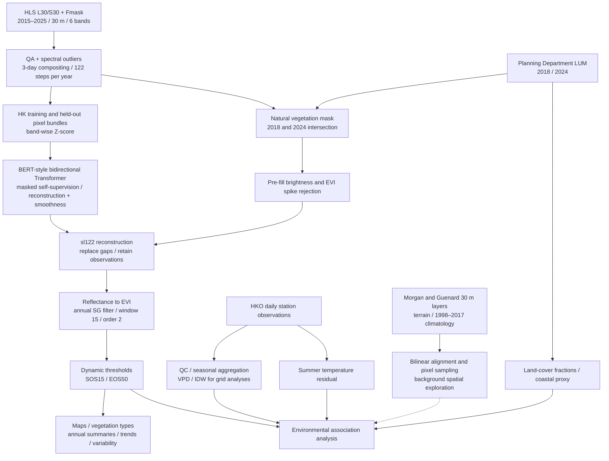

# Hong Kong HLS phenology: data dictionary and workflow

[中文](DATA_AND_WORKFLOW_ZH.md) · [Project home](../README.md) · [Final figures](../figures/final)

Checked against repository code at `c911b1c` on 2026-11-06. This document describes inputs, derived variables, preprocessing purposes, and code entry points. The main analysis uses **2015–2025, 30 m, EVI, sl122 reconstruction, SG15, and SOS15/EOS50**. Main figures are 01–07, 09, and 10; figure 08 and alternative algorithms remain exploratory/comparison outputs. Native resolution, resampled grid spacing, and statistical analysis scale are distinguished throughout.

## 1. Data inventory and provenance

| Dataset | Provider/authors and access | Spatial and temporal information | Role and project assets |
|---|---|---|---|
| HLS v2 L30/S30 surface reflectance and Fmask | NASA HLS; underlying Landsat missions operated by USGS/NASA and Sentinel-2 by ESA; [HLS](https://hls.gsfc.nasa.gov/); [L30](https://doi.org/10.5067/HLS/HLSL30.002), [S30](https://doi.org/10.5067/HLS/HLSS30.002) | 30 m; irregular acquisitions; combined nominal opportunities approximately every 2–3 days, varying with year, constellation, and orbit—**not a cloud-free observation interval**. Project period: 2015–2025 | Six-band pretraining and reconstruction; `granules/*.npz`, `granules.json`, `meta.json` |
| Hong Kong Land Utilization Map (LUM), 2018 and 2024 | Planning Department, HKSAR Government; [land-use information](https://data.gov.hk/en-data/dataset/hk-pland-pland1-land-utilization-in-hong-kong-raster-grid); [government open-data catalogue](https://data.gov.hk/en/) (search Land Utilization in Hong Kong) | Native 10 m; end-2018/end-2024 categorical snapshots, not annual observations; modal resampling to 30 m | Natural-vegetation mask, vegetation classes, urban/green fractions; `phenology/landuse/` |
| Hong Kong terrain, long-term climate, and urbanicity rasters | Morgan & Guénard; [dataset, CC BY 4.0](https://doi.org/10.6084/m9.figshare.6791276); [paper](https://doi.org/10.5194/essd-11-1083-2019); [variable table](https://ndownloader.figshare.com/files/14628722). Underlying terrain: Lands Department; climate observations: HKO | Published 30 m grid; terrain derived from 5 m data. Climate represents **1998–2017** long-term statistics, monthly climatologies, and annual/quarterly indices, not annually varying 2015–2025 climate | Background spatial exploration; `phenology/factors30/`, sampled by `sample_factors30.py` |
| HKO daily meteorology and station metadata | Hong Kong Observatory, HKSAR Government; [stations](https://www.hko.gov.hk/en/cis/stn.htm); [climate information](https://www.hko.gov.hk/en/cis/climat.htm); [example temperature CSV](https://data.weather.gov.hk/weatherAPI/hko_data/csdi/dataset/daily_HKO_TEMP_ALL.csv) | Daily point observations; record length and available variables differ by station. Analysis calendar: 2014–2025, allowing cross-year winter windows for 2015; response years: 2015–2025. No native 30 m meteorological resolution | Temperature, dew point, rainfall, wind, and derived VPD; `phenology/climate/` |
| Project training/held-out bundles and vegetation cube | Compiled by this project; [Hugging Face dataset](https://huggingface.co/datasets/ZiyunPOLYU/hk-hls-phenology); [data card](../hf_dataset/README.md) | Hong Kong only; 1342 steps = 11 years × 122 steps, six bands. Approximately 37,484 training and 4,685 held-out pixels according to the data card, not recounted for this documentation | `imputator_hk/train.nc`, `test.nc`, `phenology/veg_cube.nc`; derived packaging, not an independent observation source |
| Model weights, reconstructed series, and phenology | This project; [model Hub](https://huggingface.co/ZiyunPOLYU/hk-hls-imputator); [repository weights](../imputator_ssl/checkpoints) | sl122/244/366 mean 122/244/366 three-day steps, approximately 1/2/3 years. Phenology: annual 30 m outputs | Hub model card describes sl366. Main phenology requires the matching sl122 checkpoint; these are not interchangeable |

**Extent and coordinates.** The upper-left 1830 × 1830 window of HLS tile 49QHE uses EPSG:32649 (WGS84/UTM zone 49N), with 30 m grid spacing. Auxiliary longitude/latitude are in degrees; projected coordinates and pixel size are in metres. The rectangular window includes non-vegetated land and water and is not equivalent to Hong Kong's vegetation area. The affine transform is stored in `meta.json`; `row/col` are zero-based, dimensionless pixel indices.

## 2. Values, units, and physical interpretation

### 2.1 HLS reflectance and quality flags

Surface reflectance is the dimensionless ratio of surface-reflected to incident radiation after atmospheric correction. It is not radiance, temperature, or biomass. Red absorption, near-infrared scattering, and shortwave-infrared sensitivity to water content jointly characterize seasonal vegetation dynamics.

| Project channel | L30 / S30 | Main physical information |
|---|---|---|
| Blue | B02 / B02 | Visible reflectance and sensitivity to residual cloud/aerosols; used in EVI and brightness screening |
| Green | B03 / B03 | Green visible reflectance |
| Red | B04 / B04 | Reflectance associated with chlorophyll absorption |
| NIR | B05 / **B8A** | Leaf/canopy structural scattering; S30 uses narrow NIR B8A, not broad B08 |
| SWIR1 | B06 / B11 | Vegetation/soil water content and moisture background |
| SWIR2 | B07 / B12 | Reflectance related to water, dry matter, and surface background |

| Value | Range, encoding, and interpretation |
|---|---|
| Reflectance and DN | Stored as `int16`, with `ρ=DN×0.0001`; 10000 DN corresponds to reflectance 1. The nominal physical reference is 0–1, but retrieved source values can be negative or exceed 1. This is not an observed min–max. The `int16` representation range, −32768 to 32767, is also not a scientific validity range; source validity must follow HLS metadata/documentation. |
| Missing values | Source HLS fill is −9999; project cubes use **0 as missing**. A project zero therefore cannot also be interpreted as an observed zero reflectance. Missing-value semantics must be restored before modelling/statistics. |
| Fmask | `uint8` bit field, 0–255; 255 is fill. Bits 0–5 denote cirrus, cloud, adjacent cloud, shadow, snow/ice, and water; bits 6–7 encode aerosol level. Values are not a continuous physical quantity. Main compositing excludes bits 0–5 (including water) and fill. Land-use masking further restricts the analysis domain; bits 6–7 are not additionally screened by this code. |
| Z-score | `z=(DN−μ_band)/σ_band`; dimensionless and unbounded. Zero denotes the training band mean, not raw DN zero. Training and inference use `band_mean/band_std` from `train.nc`. |

Compositing outlier rejection uses fixed reference statistics in code (Blue, Green, Red, NIR, SWIR1, SWIR2 order): `μ=[405.80286,627.62134,511.61603,2351.3054,1401.8135,767.9902]`, `σ=[499.76883,524.465,585.40576,1158.5311,725.94995,545.9461]`, both in DN. These serve the 4σ screen; model standardization reads training-file statistics. The two sets should not be assumed identical without verification.

### 2.2 Land use and natural vegetation

Codes are categorical, dimensionless identifiers, not percentages. Natural vegetation comprises **71 woodland, 72 shrubland, 73 grassland, and 74 mangrove**. Agriculture (61) is excluded from the main natural-vegetation analysis. The project's urban set is `1,2,3,11,21,22,23,31,41,42,43,44`, used for masking and fractions. Source nodata is −128; resampled background is 0.

The main mask retains natural vegetation in both 2018 and 2024 and excludes urban classes in either year. The vegetation class need not be identical across snapshots; the intersection does not establish unchanged cover throughout 2015–2025. If the 2018 file is absent, `apply_veg_mask.py` falls back to 2024 alone; the actual input availability must therefore be recorded. The vegetation mask is binary 0/1, with 1 meaning retained.

### 2.3 Long-term environmental rasters actually sampled

The following nine static layers are explicitly loaded by `sample_factors30.py`; monthly layers are selected by filename prefix. Other layers distributed by the source are not automatically evidence of their use in this project. **P5–P95 below are reference intervals from the authors' product-wide variable table: they are percentiles, not minima/maxima or statistics recalculated for this study's vegetation pixels.**

| File/variable | Physical meaning | Units and range/reference interval |
|---|---|---|
| `elevation.tif` | Terrain height relative to the source elevation datum; affects temperature and exposure | m; P5–P95: 5–407. Zero is not a universal lower bound |
| `slope.tif` | Terrain inclination | Degrees; theoretical 0–90; P5–P95: 0–33 |
| `waterdist.tif` | Distance to source coastline, **excluding inland water bodies** | m, ≥0; P5–P95: 68–6186 |
| `urbanicity_gauss10.tif` | Impervious-surface percentage smoothed with a Gaussian kernel, σ=10 pixels | %, 0–100; P5–P95: 0–68.9. Different from the project's LUM urban fraction |
| `avars_tmean_mean.tif` | Long-term actual annual mean air temperature | °C; no universal fixed bounds; P5–P95: 20.3–23.6 |
| `avars_windsp_mean.tif` | Long-term annual mean wind speed | km/h, ≥0; P5–P95: 5.4–19.2 |
| `biovars_t_11.tif` | Mean temperature of the coldest quarter | °C; P5–P95: 14.4–17.4 |
| `biovars_t_12.tif` | Annual precipitation | mm accumulated per year, ≥0; P5–P95: 1738–2415. The filename's `t` does not make this a temperature variable |
| `biovars_t_13.tif` | Precipitation of the wettest month | mm accumulated per month, ≥0; P5–P95: 345–521 |
| `monthly/tmean_*.tif` | Long-term mean temperature for each calendar month | °C; no fixed bounds; climatology, not individual year–month observations |
| `monthly/prec_*.tif` | Long-term precipitation for each calendar month | mm/month accumulated depth, ≥0; empirical monthly ranges require raster statistics |
| `monthly/windsp_*.tif` | Long-term mean wind speed for each calendar month | km/h, ≥0; empirical monthly ranges require raster statistics |

The source authors generated climatologies using regression on terrain and other predictors followed by thin-plate-spline interpolation of residuals. Project preprocessing converts nodata to NaN, reprojects/resamples continuous rasters bilinearly to the HLS grid, and samples vegetation pixels into `veg_factors.npz`. The purpose is spatial alignment; **resampling neither increases observation density nor converts climatology into interannual meteorology**.

### 2.4 HKO daily observations and derived variables

Download template: `https://data.weather.gov.hk/weatherAPI/hko_data/csdi/dataset/daily_{station}_{variable}_ALL.csv`, where variables are `TEMP/DEW/RF/WSPD`. Availability differs by station. Dates use Hong Kong local time (UTC+8).

| Variable | Physical meaning | Units, range, and aggregation |
|---|---|---|
| TEMP | Daily mean near-surface air temperature, not satellite land-surface temperature | °C; no project-wide fixed bounds; seasonal averages of daily values |
| DEW | Daily mean dew-point temperature, describing atmospheric moisture | °C; no fixed bounds; paired with same-station TEMP to estimate VPD |
| RF | Daily accumulated rainfall as equivalent water depth | mm; 1 mm=1 L/m²; valid values ≥0; summed over a season/window |
| WSPD | Daily mean wind speed | **km/h**, ≥0; 1 km/h=1/3.6 m/s; averaged seasonally, not to be mislabelled m/s |
| Station coordinates/elevation | Observation location and terrain setting | Longitude/latitude in degrees; elevation in m. Station availability flags are not continuous weather variables |
| VPD | Difference between saturation and actual vapour pressure; atmospheric evaporative demand | kPa, constrained to ≥0 in code; 1 kPa=1000 Pa. Approximate daily VPD derived from daily mean temperature/dew point |

VPD is calculated at stations before spatial interpolation:

$$e_s(T)=0.6108\exp\left(\frac{17.27T}{T+237.3}\right),\qquad VPD=\max[e_s(T)-e_s(T_d),0].$$

This daily-mean approximation is not the mean of hourly VPD and does not directly measure canopy water stress. Main pairs are SOS versus MAM (March–May) VPD, and EOS versus JJA (June–August) and SON (September–November) temperature.

**Preprocessing and purpose.** Non-numeric entries become NaN; duplicate dates are averaged; a complete daily index exposes gaps. The current parser reads the completeness field but **does not explicitly filter on it**. Main seasonal windows require ≥80% daily coverage. Grid analyses use the nearest eight stations with `1/d²` weights, a 0.05 km distance floor, and weight renormalization for missing stations. Interpolation to cell centres matches analysis scale; it does not produce measured 30 m weather. Territory-wide scatter plots instead aggregate the daily spatial station mean seasonally and should not be described as grid IDW.

### 2.5 Derived products: ranges and interpretation

| Product/variable | Units and range | Meaning and processing purpose |
|---|---|---|
| Three-day cube | DN; 122 steps/year, 1342 steps total | Regular model time axis. Labels are DOY 1,4,…,364; the last bin includes remaining dates, not an assumption of 366 days every year |
| Reconstructed reflectance | DN; predictions inverse-scaled, rounded, lower-clipped to 0, then cast to int16; **no explicit upper clip at 10000** | Only missing positions are replaced; cleaned observations retained. Estimates are not additional cloud-free acquisitions |
| EVI | Dimensionless; vegetation values often positive; **not mathematically restricted to [−1,1]** | `2.5(NIR−Red)/(NIR+6Red−7.5Blue+1)`. Before calculation, each DN/10000 band is clipped to [0,1]; denominator magnitude ≤1e−6 yields NaN |
| SOS15 / EOS50 | DOY, with 1=1 January; valid interpolated crossings lie within 1–364 and may be fractional; invalid values NaN | Relative-amplitude rising 15% / falling 50% crossings. Remotely sensed canopy-greenness transitions, not direct species-level leaf-out/leaf-fall dates |
| Growing-season length | Days; EOS−SOS | Main downstream paired analysis excludes EOS≤SOS+30 |
| Phenology trend / interannual SD | Days/year; days | Date slopes may be positive/negative; SD≥0. Means, medians, and summaries of pixel slopes are distinct statistics |
| LUM urban/natural-vegetation fraction | Proportion [0,1]; multiply by 100 for % | Class pixel count divided by **land** pixel count, not the entire sea-containing rectangle. Main context scatter scale: 2 km |
| LUM coastal-distance proxy | km, ≥0 | Distance transform to `lum<=0` background, using 0.03 km per pixel. Distinct from source `waterdist.tif`; sensitive to nodata/window boundaries |
| Summer temperature residual (`uhi` in code) | °C; positive or negative | Long-term HKO summer station temperature residual after regression on elevation and coastal distance, then IDW. Positive means warmer than expected; not satellite LST or directly measured UHI intensity |
| Pearson r / p / n | r∈[−1,1]; p∈[0,1]; n is a count | Linear association, corresponding test p-value, and paired sample size. Pooled cell–years, within-cell temporal relationships, and the 11-year territory series have different meanings |

Full raw imagery and environmental rasters were not downloaded and reprocessed for this documentation task, so no full-sample empirical extrema are invented. Apart from the cited source percentiles, ranges above are encoding limits, mathematical/physical constraints, or explicit code constraints. Any observed min/max report must exclude fill values and specify the variable, extent, years, mask, and processing version.

## 3. Visual workflow



The dashed branch is background/exploratory analysis. Environmental covariates are used downstream, **not as predictors in the six-band reconstruction model**; the model also has time and longitude/latitude information. Its target is a per-pixel multiband time series, not spatial image generation.

### 3.1 Processing order, rationale, and code

| Step | Input → output | Processing and purpose | Main code |
|---|---|---|---|
| 1. Data preparation | Source HLS → granule NPZ, index/grid metadata | Organize common bands/grid. HLS source processing already includes atmospheric correction, registration/common gridding, BRDF and cross-sensor harmonization | [Data card](../hf_dataset/README.md); **complete raw HLS/LUM download and training-bundle construction scripts are not supplied** |
| 2. Quality control/compositing | granules → `veg_cube.nc` | Exclude Fmask bits 0–5/fill; incomplete six-band observations become entirely missing; reject band-wise `abs(z)>=4`; three-day compositing suppresses anomalies and regularizes time | [composite_veg_cube.py](../composite_veg_cube.py) |
| 3. Vegetation masking | LUM2018/2024 + cube → cube `vegetation` | Modal categorical alignment avoids meaningless interpolated classes; exclude agriculture/urban cover and restrict natural vegetation | [apply_veg_mask.py](../apply_veg_mask.py) |
| 4. Pretraining | `train.nc/test.nc` → checkpoint | Band-wise Z-score balances channel scales; non-overlapping 122-step annual windows; mask valid observations to create self-supervision. Current masking ratio is sampled between 0.4 and 0.8, not fixed at 80% for every example | [Launcher](../train_imputator_window_ablation.sh), [loader/scaling](../imputator_ssl/data_provider/data_loader.py), [model/loss](../imputator_ssl/models/Transformer.py), [smoothness loss](../imputator_ssl/utils/losses.py) |
| 5. Pre-fill outlier rejection | cube → `veg_cube_bolton.nc` | Blue increases against both valid neighbours: threshold `0.03(1+Δday/30)`; red increase >1.5×blue increase exempts the corresponding comparison. Reject EVI deviations >0.1 from the time-linear neighbour bridge, outside both neighbours, with neighbour span <90 days. All six bands become missing to reduce residual-cloud contamination | [bolton_clean.py](../bolton_clean.py), [apply_bolton_clean.py](../apply_bolton_clean.py) |
| 6. Reconstruction | cleaned cube + sl122 weights → `veg_filled_sl122.nc` | Same training scaler; disable artificial masking, predict gaps, inverse-scale, retain observed values | [impute_fast.py](../impute_fast.py), [prediction branch](../imputator_ssl/models/Transformer.py); implementation qualification below |
| 7. EVI/phenology | filled cube → `phenology_threshold_sl122_evi.nc` | Fill reflectance first, then calculate EVI. Annual SG15/order 2 suppresses short-term fluctuations while retaining seasonality. Separate left/right minima define limb amplitudes; crossings are linearly interpolated | [EVI function](../phenology_hplm.py), [phenology_threshold.py](../phenology_threshold.py) |
| 8. Spatiotemporal summaries | annual dates → figures 04–06, 10 | Maps, annual summaries, vegetation classes, and interannual SD; retain effective-year and aggregation definitions | [plot_threshold_maps.py](../plot_threshold_maps.py), [analyze_veg_types.py](../analyze_veg_types.py), [analyze_date_variance.py](../analyze_date_variance.py), [annual summaries/trends](../analyze_driver_grids.py) |
| 9. Environmental preparation | HKO/LUM/static rasters → station/grid/pixel factors | Missing-value handling, seasonal summaries, VPD, IDW; categorical fractions and continuous rasters treated separately | [download_hko.py](../download_hko.py), [sample_factors30.py](../sample_factors30.py), [analyze_driver_grids.py](../analyze_driver_grids.py) |
| 10. Associations/figures | dates + environmental factors → figures 07, 09 and tables | Figure 07: territory and 1/2/5/10 km. Figure 09: 2 km context associations. Scale and excluding-2015 sensitivity analyses assess stability | [Territory series](../plot_driver_scatters.py), [figure 07](../plot_driver_grid_scales.py), [figure 09](../analyze_context_scales.py), [earlier/exploratory analyses](../analyze_drivers.py) |
| 11. Observation/reconstruction displays | observed/filled cube → figures 01–03 | Observation availability, reconstructed imagery, and EVI trajectories; visual agreement is not independent validation | [Observation quality](../plot_valid_cloud_obs_per_year.py), [trajectory reconstruction comparison](../plot_window_fill.py); complete layout-generation entry points for final figures 02/03 are not explicitly mapped in the repository |

The training configuration uses six layers, eight heads, hidden dimension 256, and feed-forward width 1024. The objective combines masked-valid-observation MSE and second temporal difference smoothness, both weighted 1. Within each sequence, time positions are ranked by **mean absolute error across supervised channels**; up to five highest-error positions are removed from reconstruction supervision subject to retaining at least eight supervised elements. This does not delete source observations or remove smoothness constraints there. The launcher currently starts sl122; sl244/366 belong to other configurations/existing weights, not additional automatically executed calls in that script.

Phenology checks include at least 12 finite reconstructed/smoothed steps, an interior peak, limb amplitude ≥**0.04**, and minimum-to-peak separation of at least three steps. **The 0.1 value is the pre-fill EVI spike-deviation threshold, not the main phenology amplitude threshold**; 12 finite steps do not mean 12 original cloud-free acquisitions. The extractor checks a 30-day season for matching 15%/15% and 50%/50% pairs; main downstream analysis additionally checks the selected SOS15/EOS50 pair.

## 4. Reproduction entry points and implementation boundaries

Path configuration: [hk_paths.py](../hk_paths.py). Prepare Hub data, both LUM snapshots, any required static rasters, and a matching sl122 checkpoint first. The following is a **Bash/Linux + CUDA** example. Inference defaults use shared memory and multiple GPUs; adapt to available hardware rather than treating this as a native Windows command sequence.

```bash
export HK_DATA_ROOT="$PWD/data"
hf download ZiyunPOLYU/hk-hls-phenology --local-dir "$HK_DATA_ROOT"
# For raw granules, run composite_veg_cube.py first; skip if using the Hub cube.
python apply_veg_mask.py
# To retrain: bash train_imputator_window_ablation.sh
python apply_bolton_clean.py
python impute_fast.py --stage all --seq 122 --n-shards 1 \
  --src "$HK_DATA_ROOT/phenology/veg_cube_bolton.nc" \
  --dst "$HK_DATA_ROOT/phenology/veg_filled_sl122.nc" \
  --ckpt imputator_ssl/checkpoints/HK-Imputator-optical6-topk5-s1-sl122/checkpoint.pth
python phenology_threshold.py --window 15 \
  --src "$HK_DATA_ROOT/phenology/veg_filled_sl122.nc" \
  --dst "$HK_DATA_ROOT/phenology/phenology_threshold_sl122_evi.nc"
python plot_threshold_maps.py
python download_hko.py
python analyze_driver_grids.py
python plot_driver_scatters.py
python plot_driver_grid_scales.py
python analyze_context_scales.py
# Optional long-term background branch: python sample_factors30.py
```

### Implementation details to retain

1. **Three-day “median”.** `composite_veg_cube.py` updates an existing composite by taking its median with each new scene, in asynchronous completion order. For more than two scenes per bin this is not an exact all-scene median and may depend on order. Preserve the compositing version and input manifest.
2. **Inference missingness mask.** Current `impute_fast.fill_batch()` replaces standardized NaN with zero before calling the model and supplies no `valid_mask`. The model infers missingness with `isnan`, so those positions are treated as finite in its default mask. The current path therefore infers on mean-filled standardized gaps and writes predictions back only to original DN gaps; it must not be described as passing an explicit correct missingness mask. Audit this behaviour before formal reproduction/method claims. This documentation records it without changing the algorithm.
3. **Data/weight preparation boundary.** The Hub reports training/held-out pixel counts, but the complete original download, sample selection/splitting, and packaging procedure is absent from this repository. A random split or independent cross-region test cannot be inferred. sl122 requires matching weights and scaler; default sl366 is not the main-result configuration.
4. **Resolution and attribution.** The 30 m phenology grid, 30 m climatology rasters, station interpolation, and 1–10 km analysis cells have different information scales. Territory-wide figure 07 uses annual phenology **medians** and station-mean climate; context analysis uses multi-year pixel medians and cell means. Associations remain exploratory: r alone cannot establish climatic/urban causal effects, particularly with 11 years, spatial dependence, and multiple comparisons.

## 5. Sources and methodological references

- NASA HLS v2: [project and product documentation](https://hls.gsfc.nasa.gov/); product DOIs in the inventory. Retain source versions, retrieval dates, and source conditions with raw data.
- Planning Department, HKSAR Government: [Land Utilization in Hong Kong](https://data.gov.hk/en-data/dataset/hk-pland-pland1-land-utilization-in-hong-kong-raster-grid), 2018/2024 rasters, classification metadata, and terms of use.
- Morgan, B., & Guénard, B. (2019). New 30 m resolution Hong Kong climate, vegetation, and topography rasters indicate greater spatial variation than global grids within an urban mosaic. *Earth System Science Data*, 11, 1083–1098. [doi:10.5194/essd-11-1083-2019](https://doi.org/10.5194/essd-11-1083-2019). Dataset: Morgan & Guénard (2018), [doi:10.6084/m9.figshare.6791276](https://doi.org/10.6084/m9.figshare.6791276).
- Hong Kong Observatory: station metadata, daily TEMP/DEW/RF/WSPD CSVs, and data-completeness documentation; links above.
- Bolton, D. K., et al. (2020). Continental-scale land surface phenology from harmonized Landsat 8 and Sentinel-2 imagery. *Remote Sensing of Environment*, 240, 111685. [doi:10.1016/j.rse.2020.111685](https://doi.org/10.1016/j.rse.2020.111685). This project adapts the brightness-screening rationale and implements bidirectional EVI despiking; it is not a complete reproduction of that paper's pipeline.
- Huete, A., et al. (2002). Overview of the radiometric and biophysical performance of the MODIS vegetation indices. *Remote Sensing of Environment*, 83, 195–213. [doi:10.1016/S0034-4257(02)00096-2](https://doi.org/10.1016/S0034-4257(02)00096-2). Background for EVI.

Licences attached to project code/packaging do not replace the attribution and licence conditions of upstream HLS, government, and Figshare data.
