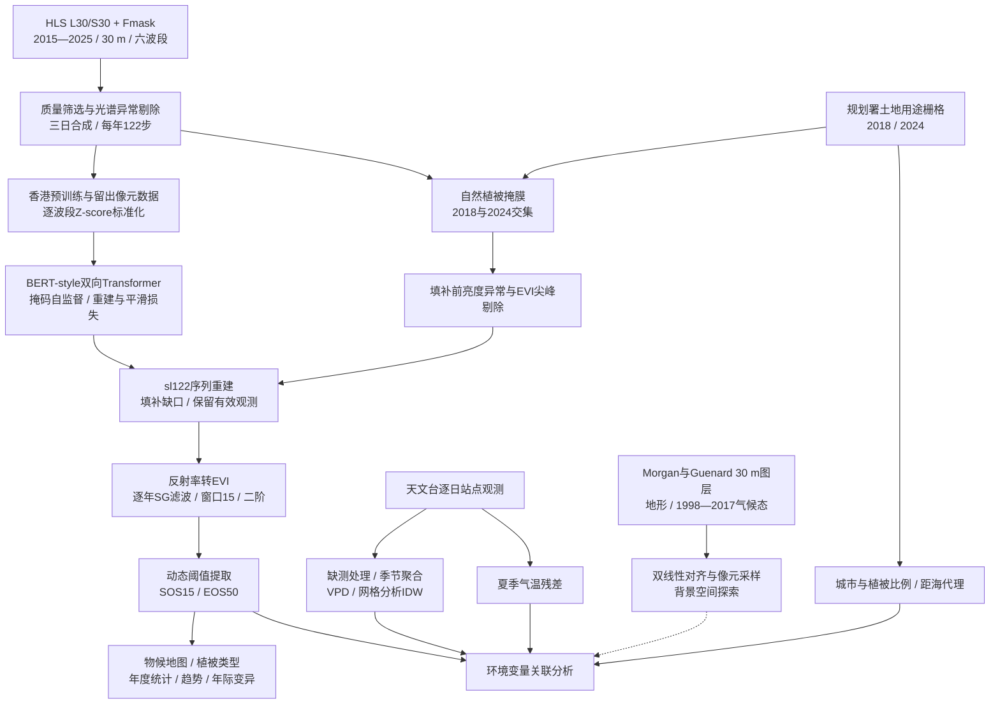

# 香港 HLS 物候：数据字典与工作流

[English](DATA_AND_WORKFLOW_EN.md) · [项目首页](../README.md) · [最终图件](../figures/final)

本文依据仓库代码版本 `c911b1c` 核对（2026-11-06），说明实际输入、派生变量及代码入口。主分析为 **2015—2025年、30 m、EVI、sl122重建、SG15、SOS15/EOS50**。主图为01—07、09、10；08和其他算法保留作探索/对照。数据来源的空间粒度、重采样后的网格和统计分析尺度分别说明。

## 1. 数据全景与来源

| 数据 | 提供机构/作者与链接 | 时空信息 | 项目用途与本地资产 |
|---|---|---|---|
| HLS v2 L30/S30地表反射率及Fmask | NASA HLS；Landsat原始任务由USGS/NASA运行，Sentinel-2由ESA运行；[HLS产品](https://hls.gsfc.nasa.gov/)；[L30](https://doi.org/10.5067/HLS/HLSL30.002)、[S30](https://doi.org/10.5067/HLS/HLSS30.002) | 30 m；不规则过境；多星联合名义观测频次约2—3天，随年代、卫星配置和轨道变化，**并非无云频次**。本研究2015—2025 | 六波段预训练与序列重建；`granules/*.npz`、`granules.json`、`meta.json` |
| 香港土地用途栅格LUM 2018、2024 | 香港特区政府规划署；[土地用途资料](https://data.gov.hk/en-data/dataset/hk-pland-pland1-land-utilization-in-hong-kong-raster-grid)；[政府开放数据目录](https://data.gov.hk/en/)（检索Land Utilization in Hong Kong） | 原始10 m；2018及2024年末分类快照，非逐年时序；项目以众数重采样到30 m | 自然植被筛选、植被类型、城市/绿地比例；`phenology/landuse/` |
| 香港地形、长期气候与城市化栅格 | Morgan & Guénard；[数据及许可CC BY 4.0](https://doi.org/10.6084/m9.figshare.6791276)；[论文](https://doi.org/10.5194/essd-11-1083-2019)；[变量表](https://ndownloader.figshare.com/files/14628722)；基础地形来自香港地政总署，气候观测来自HKO | 发布网格30 m；地形源为5 m；气候为**1998—2017年**长期统计、12个月气候态及年/季度指标；并非2015—2025逐年气候 | 地形/气候背景的空间探索；`phenology/factors30/`，由`sample_factors30.py`采样 |
| HKO逐日站点气象及站点元数据 | 香港特区政府香港天文台；[站点表](https://www.hko.gov.hk/en/cis/stn.htm)；[气候资料](https://www.hko.gov.hk/en/cis/climat.htm)；[CSV示例：HKO气温](https://data.weather.gov.hk/weatherAPI/hko_data/csdi/dataset/daily_HKO_TEMP_ALL.csv) | 日尺度、站点观测；各站记录长度不同；分析日历2014—2025（支持2015冬季跨年窗口），目标年份2015—2025；没有原生30 m分辨率 | 气温、露点、降雨、风速及VPD；`phenology/climate/` |
| 项目预训练/留出数据与植被立方体 | 本项目整理；[Hugging Face数据](https://huggingface.co/datasets/ZiyunPOLYU/hk-hls-phenology)；[数据卡](../hf_dataset/README.md) | 香港同一区域；1342步=11年×122步，6波段；训练约37,484像元，留出约4,685像元（数据卡记录，非此次重新清点） | `imputator_hk/train.nc`、`test.nc`及`phenology/veg_cube.nc`；不是独立的新观测源 |
| 模型权重与重建/物候产品 | 本项目；[模型Hub](https://huggingface.co/ZiyunPOLYU/hk-hls-imputator)；[仓库权重目录](../imputator_ssl/checkpoints) | sl122/244/366分别为122/244/366个三日步，约1/2/3年；物候输出每年一幅30 m图 | Hub模型卡描述sl366；主物候需匹配sl122权重，不能直接混用 |

**覆盖范围与坐标。** HLS瓦片49QHE左上1830×1830窗口，EPSG:32649（WGS84/UTM 49N），30 m网格；经纬度辅助坐标为角度，投影坐标/像元大小为米。窗口包含非植被和水域，不能把整个矩形面积当作香港植被面积。`meta.json`存变换参数；`row/col`是从0开始的像元索引，无物理单位。

## 2. 数值、单位及物理意义

### 2.1 HLS与质量标记

地表反射率表示经大气校正后地表反射辐射相对入射辐射的比例，无量纲；它不是辐亮度、温度或生物量。植被红波段吸收、近红外散射和短波红外对含水状况的响应共同提供季节变化信息。

| 项目通道 | L30 / S30波段 | 主要物理信息 |
|---|---|---|
| Blue | B02 / B02 | 可见光反射及残余云/气溶胶敏感信息；用于EVI大气修正项及亮度异常筛选 |
| Green | B03 / B03 | 绿色可见光反射 |
| Red | B04 / B04 | 叶绿素吸收相关反射 |
| NIR | B05 / **B8A** | 叶片/冠层结构散射；不是Sentinel-2宽近红外B08 |
| SWIR1 | B06 / B11 | 植被/土壤含水及干湿背景 |
| SWIR2 | B07 / B12 | 含水、干物质和地表背景相关反射 |

| 数值项 | 范围、编码与解释 |
|---|---|
| 反射率与DN | 项目保存`int16`，`ρ=DN×0.0001`，即10000 DN对应反射率1；名义物理参考0—1。源产品可能出现负值或>1的反演值，不能将名义范围当作实测极值。`int16`表示范围−32768—32767也不是科学有效范围；源产品有效性应按HLS元数据/指南判断。 |
| 缺失 | HLS源填充值−9999；项目立方体以**0表示缺失**，因此0不能同时解释为实测零反射率。建模和统计前应恢复缺失语义。 |
| Fmask | `uint8`位编码0—255，255为填充；bit0卷云、bit1云、bit2邻云、bit3云影、bit4雪/冰、bit5水体，bit6—7气溶胶等级。数值大小没有连续物理意义。主合成排除bit0—5（包括水体）和填充；随后还以土地用途限制分析范围，代码未额外以bit6—7筛选。 |
| Z-score | `z=(DN−μ_band)/σ_band`，无量纲、无固定上下界；0表示训练统计均值，不表示原始DN=0。训练与推理共用`train.nc`中的`band_mean/band_std`。 |

合成异常筛选使用代码内固定参考统计量（依次Blue、Green、Red、NIR、SWIR1、SWIR2）：`μ=[405.80286,627.62134,511.61603,2351.3054,1401.8135,767.9902]`、`σ=[499.76883,524.465,585.40576,1158.5311,725.94995,545.9461]`，单位均为DN。它们用于4σ筛选；模型标准化则读取训练文件统计量，两者不能未经核对视为同一组。

### 2.2 土地用途与自然植被

分类代码无物理单位，也不是百分比。自然植被代码为**71林地、72灌丛、73草地、74红树林**；61农业不进入主自然植被分析。城市类别集合为`1,2,3,11,21,22,23,31,41,42,43,44`，按项目实现用于掩膜及比例计算。源栅格nodata为−128，重采样后背景为0。

主掩膜要求像元在2018和2024均属于自然植被，并排除任一年城市类；不要求两年植被类别相同，也不能证明2015—2025每年均未变化。若2018文件缺失，`apply_veg_mask.py`会退回2024单年掩膜，应记录实际运行条件。植被掩膜为0/1二值，1表示保留。

### 2.3 实际采样的长期环境栅格

下列为`sample_factors30.py`显式读取的九个静态图层，以及按前缀读取的月气候图层。发布数据包还包含其他指标，但不能据此认定它们均已用于本项目分析。**P5—P95来自作者的全产品变量表，是第5至95百分位的参考区间，不是最小—最大值，也不是本研究植被样本的重新统计。**

| 文件/变量 | 物理现实含义 | 单位及数值范围/参考区间 |
|---|---|---|
| `elevation.tif` | 相对于源高程基准的地形高度；影响温度与暴露条件 | m（米）；P5—P95：5—407；不以0为通用下限 |
| `slope.tif` | 地表倾斜角 | °（角度）；理论0—90；P5—P95：0—33 |
| `waterdist.tif` | 源海岸线到像元的距离，**不含内陆水体** | m，≥0；P5—P95：68—6186 |
| `urbanicity_gauss10.tif` | 不透水面百分比经Gaussian平滑（σ=10像元）形成的城市化背景 | %，0—100；P5—P95：0—68.9；不等于本项目LUM计算的城市比例 |
| `avars_tmean_mean.tif` | 长期实际年均气温 | °C（摄氏度）；无通用固定上下界；P5—P95：20.3—23.6 |
| `avars_windsp_mean.tif` | 长期年均风速 | km/h（公里/小时），≥0；P5—P95：5.4—19.2 |
| `biovars_t_11.tif` | 最冷季度平均气温 | °C；P5—P95：14.4—17.4 |
| `biovars_t_12.tif` | 年降水总量 | mm/年累计水深，≥0；P5—P95：1738—2415；文件中的`t`不代表该变量是温度 |
| `biovars_t_13.tif` | 最湿月份降水总量 | mm/月累计水深，≥0；P5—P95：345—521 |
| `monthly/tmean_*.tif` | 12个月各自的长期月平均气温 | °C；无固定范围；不是逐年逐月观测 |
| `monthly/prec_*.tif` | 12个月各自的长期月降水量 | mm/月累计水深，≥0；各月实际范围需从栅格统计 |
| `monthly/windsp_*.tif` | 12个月各自的长期月平均风速 | km/h，≥0；各月实际范围需从栅格统计 |

源作者用地形等变量回归及残差薄板样条插值构建气候态。本项目将nodata转NaN、连续变量双线性重投影/采样到HLS网格，输出`veg_factors.npz`，以实现像元空间匹配；**重采样不增加气象观测密度，也不使长期气候态成为年际驱动数据**。

### 2.4 HKO逐日气象与派生变量

下载路径模板为`https://data.weather.gov.hk/weatherAPI/hko_data/csdi/dataset/daily_{station}_{variable}_ALL.csv`，变量为`TEMP/DEW/RF/WSPD`；不同站点可用变量不同。时间为香港本地日期（UTC+8）。

| 变量 | 物理意义 | 单位、范围与聚合 |
|---|---|---|
| TEMP | 日平均近地面空气温度，非卫星地表温度 | °C；不存在项目统一固定上下界；季节取日值平均 |
| DEW | 日平均露点温度，表征空气水汽状况 | °C；无固定上下界；与同站TEMP配对估算VPD |
| RF | 一天累计降雨的等效水深 | mm；1 mm=1 L/m²；有效值≥0；季节/窗口内累加 |
| WSPD | 日平均风速 | **km/h**，≥0；1 km/h=1/3.6 m/s；季节取平均，不得误作m/s |
| 站点坐标/高程 | 站点位置及地形背景 | 经纬度°；高程m；站点表可用性标记不是连续气象变量 |
| VPD | 空气饱和水汽压与实际水汽压差，反映大气蒸发需求 | kPa，代码约束≥0；1 kPa=1000 Pa；使用日平均温度/露点得到近似日尺度VPD |

VPD在站点端先计算：

$$e_s(T)=0.6108\exp\left(\frac{17.27T}{T+237.3}\right),\qquad VPD=\max[e_s(T)-e_s(T_d),0].$$

这是由日均值推算的空气干燥度指标，不等于逐小时VPD平均，也不直接等于冠层水分胁迫。主关系为SOS与MAM（3—5月）VPD、EOS与JJA（6—8月）/SON（9—11月）气温。

**预处理及目的：** 非数值转NaN，同日重复记录取平均，补齐日期索引以识别缺测；当前解析器读取完整性字段但**未显式按该字段过滤**。主季节窗口要求≥80%日值可用。网格分析以最近8站、`1/d²`权重插值到单元中心，距离下限0.05 km、缺测时重新归一权重；这是尺度匹配，不是30 m实测气候。全港散点则使用站点日值的空间平均后季节聚合，不能与网格IDW混称。

### 2.5 派生产品：范围与解释

| 产品/变量 | 单位与范围 | 含义、处理与目的 |
|---|---|---|
| 三日立方体 | DN；每年122步、11年1342步 | 规则时间格网便于建模；标签DOY=1,4,…,364；末箱包含该年剩余日期，不代表每年固定366天 |
| 重建反射率 | DN；推理值反标准化、四舍五入、下限截0后转int16，**无显式10000上限** | 仅替换原始缺失位置，保留清洗后有效观测；是模型估计，不是新增无云观测 |
| EVI | 无量纲；常见植被值为正，**公式不保证落在[−1,1]** | `2.5(NIR−Red)/(NIR+6Red−7.5Blue+1)`；计算前各波段DN/10000裁剪至[0,1]，分母绝对值≤1e−6时NaN |
| SOS15 / EOS50 | DOY（日序，1=1月1日）；有效交点位于1—364，可为小数；无效NaN | 年度EVI相对幅度上升15%/下降50%的交点；是遥感冠层绿度变化日期，不直接等于逐物种展叶/落叶日期 |
| 生长季长度 | day；EOS−SOS | 日期差；主下游分析剔除EOS≤SOS+30的配对 |
| 物候趋势/年际标准差 | day/year；day | 日期年际变化斜率可正可负；标准差≥0；均值、中位数和像元趋势的汇总不是同一统计量 |
| LUM城市比例/自然植被比例 | 比例[0,1]，乘100后才是% | 城市/自然植被像元数÷单元陆地像元数，非整个含海矩形；主背景散点尺度2 km |
| LUM距海代理量 | km，≥0 | 对`lum<=0`背景做距离变换，30 m换算为0.03 km；不同于源`waterdist.tif`，可能受nodata/窗口边界影响 |
| 夏季气温残差（代码`uhi`） | °C，可正可负 | HKO长期夏温扣除高程、距海回归项后的站点残差，再IDW；正值为较预期偏暖，非卫星LST或直接测得的城市热岛强度 |
| Pearson r / p / n | r∈[−1,1]，p∈[0,1]，n为计数 | 分别为线性相关、相应检验p值和配对样本量；不能将合并单元—年份、单元内年际关系和全港11年关系混为一谈 |

完整原始影像、环境栅格未在此次文档任务中下载重算，因此不虚构全量样本极值；除上述作者百分位外，所有范围均明确为编码、数学/物理约束或代码约束。统计本研究实际min/max时，必须先去填充值，并标明变量、范围、年份、掩膜和处理版本。

## 3. 可视化工作流



虚线为背景/探索分支。环境变量用于下游关联分析，**不作为六波段重建模型的预测输入**；模型另有时间与经纬度信息。模型不是空间影像生成器，其目标是单像元多波段时序重建。

### 3.1 处理顺序、原因与主要代码

| 步骤 | 输入 → 输出 | 预处理/计算及原因 | 主要代码 |
|---|---|---|---|
| 1.数据准备 | HLS源产品 → granule NPZ、索引/网格元数据 | 整理共同空间网格及波段；源HLS已完成大气校正、配准/共同网格、BRDF与跨传感器协调等产品处理 | [数据卡](../hf_dataset/README.md)；**仓库未提供完整HLS/LUM原始下载及训练样本打包脚本** |
| 2.质量控制与合成 | granules → `veg_cube.nc` | 排除Fmask bit0—5/fill；任一波段无效时整次六波段缺失；逐波段`abs(z)>=4`剔除；三日合成降低异常并规则化时间 | [composite_veg_cube.py](../composite_veg_cube.py) |
| 3.植被掩膜 | LUM2018/2024 + cube → cube内`vegetation` | 分类图用众数对齐，避免双线性生成无意义类别；排除农业/城市，限制自然植被范围 | [apply_veg_mask.py](../apply_veg_mask.py) |
| 4.预训练 | `train.nc/test.nc` → checkpoint | 波段Z-score均衡量纲尺度；122步不重叠年度窗口；随机遮蔽有效数据形成自监督目标；当前遮蔽比例在0.4—0.8间随机取值，并非每个样本固定80% | [启动脚本](../train_imputator_window_ablation.sh)、[读取/标准化](../imputator_ssl/data_provider/data_loader.py)、[模型/损失](../imputator_ssl/models/Transformer.py)、[平滑损失](../imputator_ssl/utils/losses.py) |
| 5.重建前异常剔除 | cube → `veg_cube_bolton.nc` | 蓝波段对前后有效邻居异常增亮：阈值`0.03(1+Δday/30)`，红增量>1.5倍蓝增量时豁免相应比较；EVI偏离时间线性邻居桥>0.1且超出两邻居范围、邻居跨度<90天时剔除；整次六波段设缺失，防止云残留影响填补 | [bolton_clean.py](../bolton_clean.py)、[apply_bolton_clean.py](../apply_bolton_clean.py) |
| 6.序列重建 | cleaned cube + sl122 checkpoint → `veg_filled_sl122.nc` | 与训练同一scaler；关闭人工随机掩码，预测缺口，反标准化；保留原有效值 | [impute_fast.py](../impute_fast.py)、[模型推理分支](../imputator_ssl/models/Transformer.py)；实现核查见下文 |
| 7.EVI与物候 | filled cube → `phenology_threshold_sl122_evi.nc` | 先补反射率再计算EVI；每年SG15/二阶，抑制短期波动而保留季节形状；左右谷值分别定义两侧振幅，线性插值求阈值日期 | [EVI函数](../phenology_hplm.py)、[phenology_threshold.py](../phenology_threshold.py) |
| 8.物候空间/时间统计 | yearly dates → 图04—06、10 | 地图/年度/植被类型及标准差；检查有效年数和聚合统计口径 | [plot_threshold_maps.py](../plot_threshold_maps.py)、[analyze_veg_types.py](../analyze_veg_types.py)、[analyze_date_variance.py](../analyze_date_variance.py)、[年度统计与趋势](../analyze_driver_grids.py) |
| 9.环境变量准备 | HKO/LUM/static rasters → station/grid/pixel factors | 非数值缺测处理、季节统计、VPD计算、IDW；分类比例与连续栅格分别处理 | [download_hko.py](../download_hko.py)、[sample_factors30.py](../sample_factors30.py)、[analyze_driver_grids.py](../analyze_driver_grids.py) |
| 10.关联与出图 | dates + environmental factors → 图07、09及统计表 | 主图07：全港及1/2/5/10 km；图09：2 km背景关系；多尺度与去2015敏感性帮助判断稳定性 | [全港散点来源](../plot_driver_scatters.py)、[图07](../plot_driver_grid_scales.py)、[图09](../analyze_context_scales.py)、[早期/探索分析](../analyze_drivers.py) |
| 11.观测与重建展示 | observed/filled cube → 图01—03 | 原始观测数量、重建影像和对应EVI序列；视觉一致性不能代替独立验证 | [观测质量](../plot_valid_cloud_obs_per_year.py)、[时序重建对照](../plot_window_fill.py)；最终图02/03的完整排版生成入口未在仓库中明确对应 |

预训练配置为6层、8头、隐藏维256、前馈1024；损失为遮蔽有效点上的MSE与二阶时间差分平滑项之和（权重均1）。每序列按时间点各监督通道**平均绝对误差**排序，最多移除最高5个时间点的重建监督，同时满足至少保留8个监督元素的约束；这不是删掉原始数据，也不是取消这些位置的平滑约束。启动脚本当前实际启动sl122，sl244/366是其他配置/既有权重，不能把脚本注释当作全部自动运行。

物候有效性检查包括：重建/平滑后至少12个有限步、峰值不位于最边缘、每侧振幅≥**0.04**及谷峰间至少3步。这里**0.1是重建前EVI尖峰偏差阈值，不是主物候振幅阈值**；12步也不等于12次原始无云观测。提取器对15%/15%、50%/50%配对检查30天季长，下游主分析进一步检查SOS15/EOS50配对。

## 4. 复现入口与实现边界

路径配置见[hk_paths.py](../hk_paths.py)。先准备数据Hub资产、两期LUM、需要的静态栅格及sl122 checkpoint。以下为Bash/Linux+CUDA示例；推理默认共享内存与多GPU，需要按设备调整，不能直接当作Windows单机命令。

```bash
export HK_DATA_ROOT="$PWD/data"
hf download ZiyunPOLYU/hk-hls-phenology --local-dir "$HK_DATA_ROOT"
# 若从原始granules构建，先运行composite_veg_cube.py；Hub立方体可跳过该步。
python apply_veg_mask.py
# 需要重新训练时：bash train_imputator_window_ablation.sh
python apply_bolton_clean.py
python impute_fast.py --stage all --seq 122 --n-shards 1 \
  --src "$HK_DATA_ROOT/phenology/veg_cube_bolton.nc" \
  --dst "$HK_DATA_ROOT/phenology/veg_filled_sl122.nc" \
  --ckpt imputator_ssl/checkpoints/HK-Imputator-optical6-topk5-s1-sl122/checkpoint.pth
python phenology_threshold.py --window 15 \
  --src "$HK_DATA_ROOT/phenology/veg_filled_sl122.nc" \
  --dst "$HK_DATA_ROOT/phenology/phenology_threshold_sl122_evi.nc"
python plot_threshold_maps.py
python download_hko.py
python analyze_driver_grids.py
python plot_driver_scatters.py
python plot_driver_grid_scales.py
python analyze_context_scales.py
# 需要长期背景分支时：python sample_factors30.py
```

### 需要保留的实现说明

1. **三日“中值”实现。** `composite_veg_cube.py`逐次将已有合成值与新影像取中值，且按异步完成顺序更新；当箱内超过两景时，不等于一次性对全部影像求精确中值，并可能依赖顺序。应保留合成版本与输入清单。
2. **推理缺失掩码。** 当前`impute_fast.fill_batch()`将标准化后的NaN替换为0后传入模型，未传`valid_mask`；模型默认用`isnan`识别缺失，因此这些位置在默认掩码内被识别为有限值。当前路径实际是缺口用标准化均值填充后推理，再只回写原DN缺口；不能写成显式缺失掩码已正确传入。正式再现/方法描述前需核对这一行为；本文仅记录，未改变算法。
3. **数据/权重准备边界。** Hub记录训练/留出像元数量，但当前仓库缺少完整原始下载、样本选择/划分及打包过程，不能据此声称随机划分或跨区域独立测试。使用sl122必须与同配置权重及scaler匹配，不能使用默认sl366冒充主结果。
4. **分辨率与归因。** 30 m物候、30 m气候态栅格、站点气象插值和1—10 km分析单元具有不同信息尺度。图07全港响应是年度物候**中位数**、气候是站点平均；背景分析又采用多年度像元中位数及单元平均。相关性是探索性关联，不能单靠r证明气候/城市化因果作用，亦需考虑11年样本、空间自相关和多重比较。

## 5. 来源与方法参考

- NASA HLS v2：[项目与产品说明](https://hls.gsfc.nasa.gov/)，L30/S30产品DOI见数据清单；源产品版本、获取日期及许可应随原始数据保留。
- 香港规划署：[Land Utilization in Hong Kong](https://data.gov.hk/en-data/dataset/hk-pland-pland1-land-utilization-in-hong-kong-raster-grid)，2018/2024栅格及其分类/使用条款。
- Morgan, B., & Guénard, B. (2019). New 30 m resolution Hong Kong climate, vegetation, and topography rasters indicate greater spatial variation than global grids within an urban mosaic. *Earth System Science Data*, 11, 1083–1098. [doi:10.5194/essd-11-1083-2019](https://doi.org/10.5194/essd-11-1083-2019). 数据发布：Morgan & Guénard (2018), [doi:10.6084/m9.figshare.6791276](https://doi.org/10.6084/m9.figshare.6791276)。
- 香港天文台：站点资料、逐日TEMP/DEW/RF/WSPD CSV及相应资料完整性说明，链接见上表。
- Bolton, D. K., et al. (2020). Continental-scale land surface phenology from harmonized Landsat 8 and Sentinel-2 imagery. *Remote Sensing of Environment*, 240, 111685. [doi:10.1016/j.rse.2020.111685](https://doi.org/10.1016/j.rse.2020.111685)。本项目采用亮度异常思想并实现双向EVI尖峰筛选，不等同完整复刻该论文流程。
- Huete, A., et al. (2002). Overview of the radiometric and biophysical performance of the MODIS vegetation indices. *Remote Sensing of Environment*, 83, 195–213. [doi:10.1016/S0034-4257(02)00096-2](https://doi.org/10.1016/S0034-4257(02)00096-2)。EVI定义背景。

本项目代码/整理资产的许可不能替代HLS、政府资料及Figshare原始数据的来源归属和许可条件。
