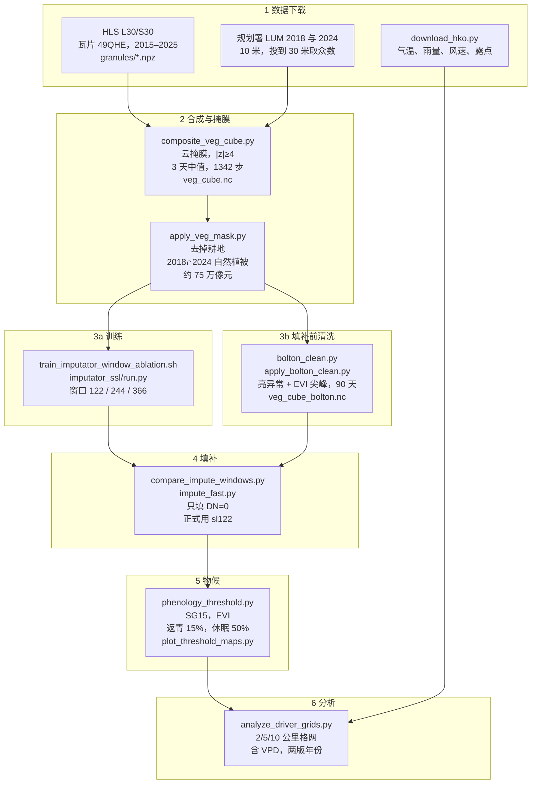

# 香港 HLS 物候流程

正式结果走下面这一条。清洗在填补之前。物候用 Savitzky–Golay 窗口 15，返青取上升段振幅的 15%，休眠取下降段振幅的 50%。双 logistic 和 SG9 只做过对照。

图：[figures/pipeline_flowchart.png](../figures/pipeline_flowchart.png)。重画：`python pipeline.py`。英文版：[PIPELINE_EN.md](PIPELINE_EN.md)。



## 每一步对应的脚本

| 步骤 | 脚本 | 输入 | 输出 |
|---|---|---|---|
| 气候下载 | `download_hko.py` | 天文台站点表和日值 CSV | `data/phenology/climate/` |
| 三天合成 | `composite_veg_cube.py` | `granules/*.npz`、`granules.json`、`meta.json`、LUM 2024 | `data/phenology/veg_cube.nc` |
| 植被掩膜 | `apply_veg_mask.py` | `veg_cube.nc`、LUM 2018 与 2024 | 同一立方体里的 `vegetation` |
| 模型训练 | `train_imputator_window_ablation.sh` → `imputator_ssl/run.py` | `data/imputator_hk/train.nc` | `imputator_ssl/checkpoints/` 下 sl122、sl244、sl366 |
| 填补前清洗 | `apply_bolton_clean.py`（规则在 `bolton_clean.py`） | `veg_cube.nc` | `veg_cube_bolton.nc` |
| 留出比较 | `compare_impute_windows.py` | 洗过的立方体、三个权重 | `window_compare/sl*.json` |
| 缺口填补 | `impute_fast.py` | `veg_cube_bolton.nc`、对应 checkpoint | `veg_filled_sl122.nc`、`sl244`、`sl366` |
| 物候提取 | `phenology_threshold.py --window 15` | `veg_filled_sl122.nc` | `phenology_threshold_sl122_evi.nc` |
| 空间图 | `plot_threshold_maps.py` | 上面的物候文件 | `figures/phenology_maps_sos15_eos50_sl122_evi.png` |
| 气候分析 | `analyze_driver_grids.py` | 物候文件、天文台日值 | `figures/driver_lag_correlations.*`、`phenology_yearly_sos15_eos50.*` |

HLS 景和土地利用栅格是本地输入，仓库里没有单独的下载脚本。训练像元 `train.nc` / `test.nc` 在 Hugging Face 数据集 `ZiyunPOLYU/hk-hls-phenology`。

## 锁定的选择

合成保留六个光学波段，反射率乘 10000，缺失记为 0。时间轴是 3 天一步，一年 122 步，2015–2025 共 1342 步。网格是瓦片左上角 1830×1830 个 30 米像元。

掩膜去掉耕地（代码 61）。林地、灌木、草地、红树林（71–74）只在 2018 和 2024 都成立、且两年都不是城市时保留。

训练是 6 波段 Transformer：256 维，8 头，6 层，前馈 1024。掩掉 80% 的时间步，每条序列丢掉误差最大的 5 步，加二阶平滑。三个窗口一起训：122、244、366。

清洗在填补之前。亮异常按 Bolton 等（2020）：蓝光相对两侧晴空日抬升就删，红光抬得更多则保留。EVI 尖峰要求前后晴空日间隔不超过 90 天，偏离线性插值超过 0.1，向上和向下都删，当天六个波段一起改为缺失。

填补只改写缺失步。sl122 一年一窗。sl244 两年一块，最后一年改用 sl122。sl366 用三年上下文，写出中间一年。物候用 sl122 填完的立方体。

物候在 EVI 上做。每年 Savitzky–Golay，窗口 15、2 阶，在峰值处切开。返青是上升段第一次到振幅 15% 的日期，休眠是下降段第一次到 50% 的日期。振幅小于 0.04、有效步少于 12、季长短于 30 天的年份丢掉。`phenology_hplm.py` 和 `phenology_from_cube.py` 的曲率日期不进入正式结果。`submit_impute_windows.sh` 末尾的 SG9 同样只是对照。

分析把 30 米日期汇总到 2、5、10 公里格网，格内取均值和标准差。站点气候反距离权重插到格心。水汽压差是 es(气温) 减 es(露点)，Tetens，单位 kPa。主结果用固定的春、夏、秋。紧贴日期滑动的 30、60、90 天会跟着日期挪，不作为主结果。年份做两版：2015–2025，以及去掉 2015。

## 正式结果怎么跑

数据根目录用 `HK_DATA_ROOT`，默认是仓库里的 `data/`。Python 用装有 PyTorch、netCDF4、rasterio、scipy 的环境。

```bash
python download_hko.py
python composite_veg_cube.py
python apply_veg_mask.py
bash train_imputator_window_ablation.sh
python apply_bolton_clean.py
python impute_fast.py --stage all --seq 122 \
  --src data/phenology/veg_cube_bolton.nc \
  --dst data/phenology/veg_filled_sl122.nc \
  --ckpt imputator_ssl/checkpoints/HK-Imputator-optical6-topk5-s1-sl122/checkpoint.pth
python phenology_threshold.py --window 15 \
  --src data/phenology/veg_filled_sl122.nc \
  --dst data/phenology/phenology_threshold_sl122_evi.nc
python plot_threshold_maps.py
python analyze_driver_grids.py
```

三个窗口一起填、以及集群上的并行任务，在 `submit_impute_windows.sh` 和 `submit_threshold.sh`。那两个脚本里的 SG9 物候可以跳过。
