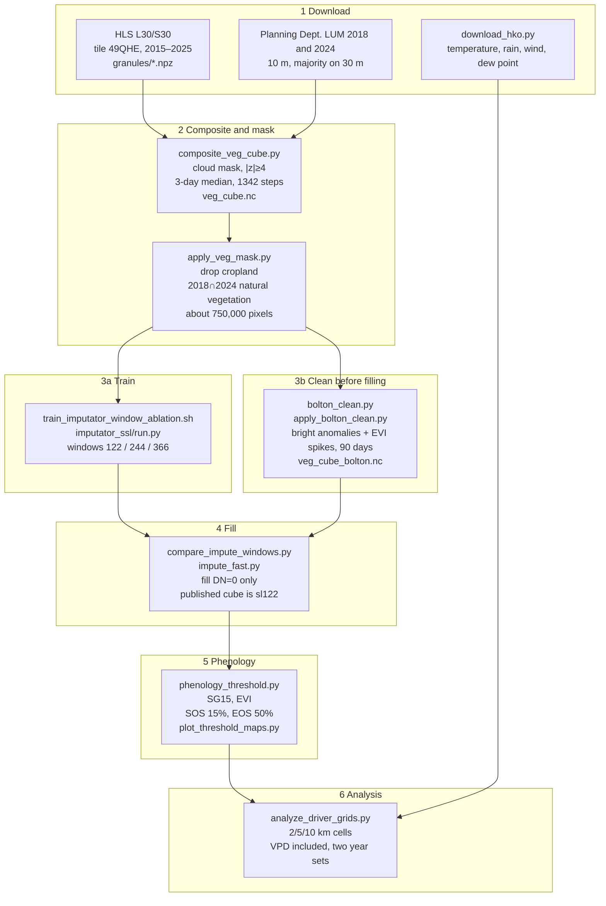

# Hong Kong HLS phenology pipeline

The published dates follow this path. Cleaning happens before gap filling. Phenology uses a Savitzky–Golay window of 15. SOS is 15% of the green-up amplitude, and EOS is 50% of the senescence amplitude. Double-logistic fits and SG9 were comparisons only.

Figure: [figures/pipeline_flowchart_en.png](../figures/pipeline_flowchart_en.png). Redraw with `python pipeline.py --lang en`. Chinese version: [PIPELINE.md](PIPELINE.md).



## Script for each step

| Step | Script | Input | Output |
|---|---|---|---|
| Climate download | `download_hko.py` | HKO station table and daily CSVs | `data/phenology/climate/` |
| 3-day composite | `composite_veg_cube.py` | `granules/*.npz`, `granules.json`, `meta.json`, LUM 2024 | `data/phenology/veg_cube.nc` |
| Vegetation mask | `apply_veg_mask.py` | `veg_cube.nc`, LUM 2018 and 2024 | `vegetation` in the same cube |
| Training | `train_imputator_window_ablation.sh` → `imputator_ssl/run.py` | `data/imputator_hk/train.nc` | sl122, sl244, sl366 under `imputator_ssl/checkpoints/` |
| Clean before filling | `apply_bolton_clean.py` (rules in `bolton_clean.py`) | `veg_cube.nc` | `veg_cube_bolton.nc` |
| Hold-out comparison | `compare_impute_windows.py` | cleaned cube, three checkpoints | `window_compare/sl*.json` |
| Gap filling | `impute_fast.py` | `veg_cube_bolton.nc`, matching checkpoint | `veg_filled_sl122.nc`, `sl244`, `sl366` |
| Phenology | `phenology_threshold.py --window 15` | `veg_filled_sl122.nc` | `phenology_threshold_sl122_evi.nc` |
| Maps | `plot_threshold_maps.py` | phenology file above | `figures/phenology_maps_sos15_eos50_sl122_evi.png` |
| Climate analysis | `analyze_driver_grids.py` | phenology file, HKO daily series | `figures/driver_lag_correlations.*`, `phenology_yearly_sos15_eos50.*` |

HLS scenes and the land-use rasters are local inputs. This repo has no separate download script for them. Training pixels `train.nc` / `test.nc` are in the Hugging Face dataset `ZiyunPOLYU/hk-hls-phenology`.

## Locked choices

The composite keeps six optical bands. Reflectance is multiplied by 10,000, and missing values are stored as 0. The time axis is one step every 3 days, 122 steps per year, 1,342 steps over 2015–2025. The grid is the upper-left 1830×1830 pixels of the tile at 30 m.

The mask drops cropland (code 61). Woodland, shrubland, grassland, and mangrove (71–74) are kept only when both 2018 and 2024 are natural vegetation and neither year is urban.

Training is a 6-band Transformer: 256 dimensions, 8 heads, 6 layers, feed-forward width 1024. Eighty percent of the time steps are masked. Each sequence drops its five worst steps, and a second-difference penalty is added. The three windows are 122, 244, and 366.

Cleaning runs before filling. Bright anomalies follow Bolton et al. (2020): a date is removed when blue reflectance rises against both clear neighbors, and kept when the red rise is larger. An EVI spike requires the surrounding clear observations to be at most 90 days apart and the EVI to sit more than 0.1 off the linear bridge, in either direction. All six bands of that date are set back to missing.

Filling overwrites missing steps only. sl122 is one year at a time. sl244 is a two-year block, and its last year uses sl122. sl366 uses a three-year context and writes the middle year. Phenology uses the sl122 cube.

Phenology is computed on EVI. Each year is smoothed with Savitzky–Golay, window 15, order 2, and split at the peak. SOS is the first rise through 15% of the amplitude. EOS is the first drop through 50% of the amplitude. A year is dropped when the amplitude is below 0.04, fewer than 12 steps are valid, or the season is shorter than 30 days. Curvature dates from `phenology_hplm.py` and `phenology_from_cube.py` are not in the published product. The SG9 step at the end of `submit_impute_windows.sh` is a comparison only.

The analysis aggregates the 30 m dates onto 2, 5, and 10 km cells and keeps the mean and the within-cell standard deviation. Station climate is inverse-distance weighted to the cell center. VPD is es(temperature) minus es(dew point), Tetens, in kPa. The reported correlations use fixed spring, summer, and autumn windows. The 30, 60, and 90 day windows that sit against the phenology date move with that date, so they are not the main result. Years are scored twice: 2015–2025, and again without 2015.

## How to reproduce the published dates

`HK_DATA_ROOT` sets the data root. The default is `data/` in this repo. The Python environment needs PyTorch, netCDF4, rasterio, and scipy.

```bash
python download_hko.py
python composite_veg_cube.py
python apply_veg_mask.py
bash train_imputator_window_ablation.sh
python apply_bolton_clean.py
python impute_fast.py --stage all --seq 122 \
  --src data/phenology/veg_cube_bolton.nc \
  --dst data/phenology/veg_filled_sl122.nc \
  --ckpt imputator_ssl/checkpoints/HK-Imputator-optical6-topk5-s1-sl122/checkpoint.pth
python phenology_threshold.py --window 15 \
  --src data/phenology/veg_filled_sl122.nc \
  --dst data/phenology/phenology_threshold_sl122_evi.nc
python plot_threshold_maps.py
python analyze_driver_grids.py
```

Filling all three windows, and the cluster jobs, are in `submit_impute_windows.sh` and `submit_threshold.sh`. The SG9 phenology inside those two scripts can be skipped.
